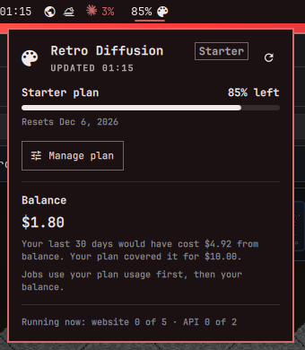

# Retro Diffusion for Omarchy

Your [Retro Diffusion](https://www.retrodiffusion.ai/) plan usage and balance in the Omarchy bar.



> Unofficial. This plugin isn't made by or affiliated with Retro Diffusion. It only reads
> your own account summary from their public API.

## What it shows

- **On the bar:** a palette icon with the plan usage you have left (`91%`), or your
  balance (`$1.80`) when you have no active plan. It turns your theme's urgent colour
  when the plan is nearly used up (10% left by default) or, without a plan, when the
  balance drops under $1.
- **In the panel:**
  - **Plan:** name, usage left with a bar, and the reset (or end) date.
  - **Balance:** your prepaid USD balance, what the last 30 days of jobs would have
    cost at balance rates, and what your plan covered it for.
  - **Running now:** website and API jobs in use out of your limit.

## Install

```bash
omarchy plugin add https://github.com/lviit/omarchy-retro-diffusion.git --enable
```

You're asked which bar section to put it in. Next to the clock (`centerEnd`) works well.

## Set up your API key

1. Create a key at <https://www.retrodiffusion.ai/app/devtools> (5 keys per account at most).
   A separate key for the bar lets you revoke it without breaking anything else.
2. Save it where the widget looks for it. This prompts for the key without echoing it
   and makes the file readable only by you:

   ```bash
   mkdir -p ~/.config/retro-diffusion && (umask 077; read -rsp "Retro Diffusion API key: " k && printf '%s\n' "$k" > ~/.config/retro-diffusion/api-key); echo
   ```

3. Middle-click the widget to refresh.

To keep the key somewhere else, set `RD_API_KEY_FILE` in the shell's environment.

## Using it

| Action | What it does |
| --- | --- |
| Left click | Open or close the panel |
| Middle click | Refresh |
| Right click | Open retrodiffusion.ai in your browser |
| `R` (panel open) | Refresh |
| `O` (panel open) | Open retrodiffusion.ai |
| `Esc` | Close the panel |

From a script:

```bash
omarchy-shell io.github.lviit.retro-diffusion status    # Starter 91% left, balance $1.80
omarchy-shell io.github.lviit.retro-diffusion refresh
omarchy-shell io.github.lviit.retro-diffusion toggle
```

## Settings

Change these in the bar's widget settings, or in the widget's entry in
`~/.config/omarchy/shell.json`.

| Setting | Default | |
| --- | --- | --- |
| `autoRefresh` | `true` | Refresh on a timer. When off, it only asks when you open the panel or refresh. |
| `refreshIntervalSec` | `300` | Seconds between refreshes, 60 to 3600. |
| `barValue` | `plan` | `plan`: usage left (falls back to balance without a plan). `balance`: always the balance. |
| `showLabel` | `true` | Show the value next to the icon (horizontal bars only). |
| `lowPlanPct` | `10` | Warn when plan usage left is at or below this percentage. |

## Privacy and network access

- **One endpoint:** `GET https://api.retrodiffusion.ai/v2/inferences/credits`, over
  HTTPS only, with a 15 second timeout and a 64 KB response limit. Nothing else is
  contacted, and nothing is sent except your key.
- **How often:** every `refreshIntervalSec` while `autoRefresh` is on, plus when you
  open the panel or refresh. With bars on several monitors, they share one request
  (see below).
- **Your key** is read from `~/.config/retro-diffusion/api-key` and passed to `curl`
  on stdin, so it never appears in the process list. It's never logged, cached or
  shown.
- **Cache:** the API's answer (the numbers the panel shows, not the key) is kept for a
  few seconds in `$XDG_RUNTIME_DIR/retro-diffusion-bar/`. That folder is private to
  your user, lives in memory, and is cleared when you log out. Its only job is
  letting the bars on all your monitors share one request.
- **Displayed data** from the API is type-checked, range-checked, stripped of control
  characters, length-limited, and always rendered as plain text.

## Requirements

Omarchy with the Quickshell-based shell (plugins and `omarchy plugin` commands),
plus `curl`, `flock` (util-linux) and `sha256sum` (coreutils), which Omarchy ships.

## Remove

```bash
omarchy plugin remove io.github.lviit.retro-diffusion
rm -r ~/.config/retro-diffusion    # your saved API key
```

The cache disappears on its own at logout.

## Development

```bash
bash tests/run_all.sh
```

The tests cover the response parser (including markup-shaped and out-of-range data),
`fetch.sh` against a fake `curl` (key handling, caching, errors, three bars refreshing
at once), that every string the UI uses exists in `i18n/en.json`, and the manifest.
They never touch the network.

Omarchy hot-reloads plugin files on save, but QML edits may not show up until you run
`omarchy restart shell`.

## License

[MIT](LICENSE)
